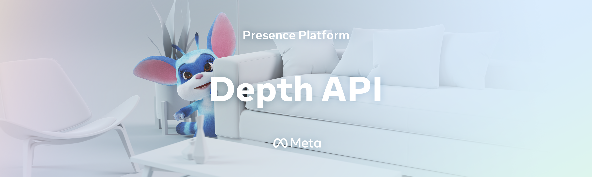
# Depth API
Depth API exposes to applications real-time, per-eye, per-frame, environment depth estimates from the headset’s point of view.
This repository shows how Depth API can be used to implement dynamic occlusions.
This technique is essential for rendering believable visual interactions between virtual and physical content in your apps, enabling a more coherent sense of reality for your users.

This README targets **Meta XR SDK v209**.

You can learn more in the [Depth API overview](https://developers.meta.com/horizon/documentation/unity/unity-depthapi-overview/).

## Health & Safety Guidelines
While building mixed reality experiences, we highly recommend evaluating your content to offer your users a comfortable and safe experience. Please refer to the [Mixed Reality H&S Guidelines](https://developer.oculus.com/resources/mr-health-safety-guideline/) before designing and developing your app using this sample project or any of our Presence Platform Features.

## Upcoming BiRP retirement

In a future update after v209, the **BiRP sample project (`DepthAPI-BiRP`) will be removed and archived**, and the **BiRP shaders package (`com.meta.xr.depthapi`) will be archived and no longer supported**. BiRP remains available in v209; we recommend URP for new projects.

## Table of Contents
- [Upcoming BiRP retirement](#upcoming-birp-retirement)
- [Dynamic Occlusion](#dynamic-occlusion)
- [Depth API Requirements](#depth-api-requirements)
- [Getting started with samples](#getting-started-with-samples)
- [Implementing Depth API](#implementing-depth-api)
  * [Getting started](#getting-started)
    + [1. Prerequisites](#1-prerequisites)
    + [2. Adding occlusions to a scene](#2-adding-occlusions-to-a-scene)
    + [3. Project Setup Tool](#3-project-setup-tool)
    + [4. Adding occlusion shaders to our objects](#4-adding-occlusion-shaders-to-our-objects)
      - [**For BiRP**](#for-birp)
      - [**For URP**](#for-urp)
    + [5. Enabling/configuring occlusions](#5-enablingconfiguring-occlusions)
      - [Occlusions on UI](#occlusions-on-ui)
    + [6. Using Environment depth bias to solve z-fighting in occlusion shaders](#6-using-environment-depth-bias-to-solve-z-fighting-in-occlusion-shaders)
    + [7. Using hands removal](#7-using-hands-removal)
    + [8. Implementing occlusion in custom shaders](#8-implementing-occlusion-in-custom-shaders)
    + [9. Using Shader Graph](#9-using-shader-graph)
      - [1. LitOccluded](#1-litoccluded)
      - [2. Stylized shaders](#2-stylized-shaders)
    + [10. Depth masking](#10-depth-masking)
    + [11. Raycasting](#11-raycasting)
    + [12. Testing](#12-testing)
    + [13. Updating from pre v67 version of Depth API](#13-updating-from-pre-v67-version-of-depth-api)
    + [14. Troubleshooting](#14-troubleshooting)
  * [Licenses](#licenses)

# Dynamic Occlusion
This repository contains two occlusion implementations: hard occlusion and soft occlusion.

* Hard occlusion is cheaper to compute, but has a jagged edge and more visible temporal instability.
* Soft occlusion is visually more appealing, but requires more GPU.


## Depth API Requirements

* **Unity 6 (6000.3.10f1)**.
* **Meta XR Core SDK v209**.
* **Meta Quest 3, Meta Quest 3S, or Meta VR Glasses**.

All required packages are already configured in the sample projects; no manual package installation is needed. To add Depth API to an existing project, follow [Implementing Depth API](#implementing-depth-api).

# Getting started with samples

### Using GitHub
First, ensure you have Git LFS installed by running this command:
```sh
git lfs install
```

Then, clone this repo using the **Code** button above, or this command:
```sh
git clone https://github.com/oculus-samples/Unity-DepthAPI
```

### Unity Projects
Get started by setting up Unity with our [Unity Set Up guide](https://developer.oculus.com/documentation/unity/book-unity-gsg/). See [Depth API Requirements](#depth-api-requirements) above for the sample editor and SDK versions.

Open `DepthAPI-URP` or `DepthAPI-BiRP`, located in the cloned Unity-DepthAPI folder. The required packages are already configured.
Both implement the same examples, and exist to showcase different rendering pipelines that Unity offers: Built-in and URP respectively.
See [Unity's render pipeline overview article](https://docs.unity3d.com/Manual/render-pipelines-overview.html) to understand the differences.

### Scenes
The scenes are located in the same path for both sample projects: `./Assets/DepthAPISample/Scenes`.

#### OcclusionToggler
This scene showcases the general setup of the occlusion feature and how to switch between different modes.

When the scene is built for device, users can press the A button on the right controller to toggle between three modes: `None`, `HardOcclusion`, and `SoftOcclusion`. With hand tracking, a right-hand thumb tap also switches modes.


#### SceneAPIPlacement
This example covers the solution for z-fighting between virtual objects and environment depth when they are placed close to real surfaces. This Unity scene utilizes the Scene API to enable the precise placement of virtual posters on detected walls. This is a worst case scenario for z-fighting; this example shows how it can be mitigated.

Supplied shaders contain a float `_EnvironmentDepthBias` property that can be changed from the code. The SceneAPIPlacement scene shows how this can be set and modified programmatically.

Depth API measurements have an inherent error that scales with distance. The environment depth bias formula is implemented accordingly. The value supplied to `_EnvironmentDepthBias` is a relative depth offset: the applied offset scales linearly with distance. Increasing the bias reduces occlusion near a real surface without moving the virtual object. We recommend using a value of around 0.06 but the value may depend on the type of content that is being placed.


#### HandsRemoval
This scene showcases the removal of hands from the depth map. In their stead we use hand tracking to render OVRHands and we use them as a mask.
> Note: Hands removal requires hand tracking to be enabled on your headset.


#### DepthMask
This scene demonstrates depth masking with wall meshes loaded from MRUK. Press **B** on the right controller to toggle whether walls contribute to occlusion, and move the right thumbstick left or right to adjust `MaskBias`. It requires room data from Space Setup. See [Depth masking](#10-depth-masking) for the API.

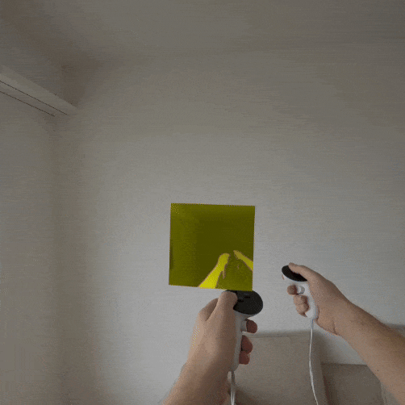

# Implementing Depth API

## Getting started

### 1. Prerequisites

Make sure you have the supported Unity setup listed above.

Ensure Passthrough is working in your project by following [these instructions](https://developer.oculus.com/documentation/unity/unity-passthrough-gs/).

### 2. Adding occlusions to a scene

To add occlusions to your scene, add one `EnvironmentDepthManager` component to your scene. Only one instance is supported, including inactive objects. This script is located in Meta XR Core SDK under `Scripts/EnvironmentDepth`, in the `Meta.XR.EnvironmentDepth` namespace.

Once you have done this, hit Ctrl-S to save your scene. You now need to add the **Passthrough Feature** to your scene (if you don’t already have it). You can use PST to handle this process automatically. This feature is described in the next section. Passthrough is essential for Depth API to function. More info on passthrough can be found in [the official documentation](https://developer.oculus.com/documentation/unity/unity-passthrough-gs/).

An app that wants to use Depth API needs to request spatial data permission during the app’s runtime. The application must prompt users to accept the `USE_SCENE` permission. Simply call this line of code wherever you wish to prompt the user with the permission request window:
```C#
UnityEngine.Android.Permission.RequestUserPermission("com.oculus.permission.USE_SCENE");
```
The manager waits for this permission to be granted before requesting depth textures. Handle a denied permission in your app and check `IsDepthAvailable` before using depth data.

Alternatively, you can check the **Scene** box under the **Permissions request on startup** section in **OVRManager**. This will ask the user to grant scene permission on app startup.

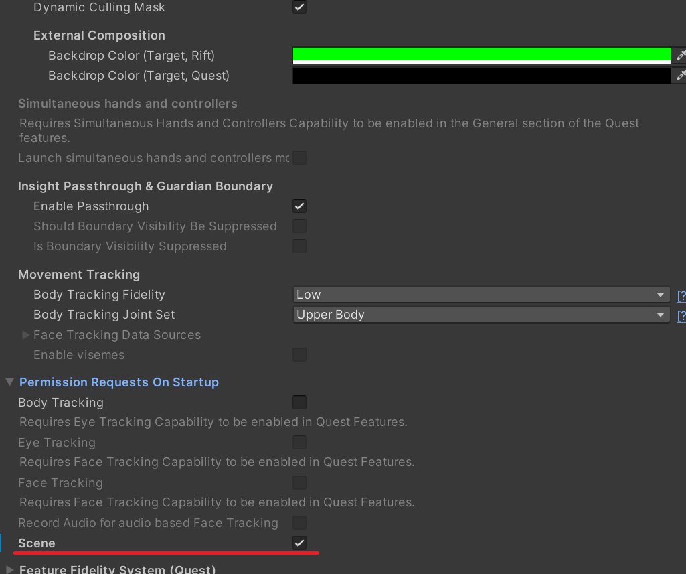

### 3. Project Setup Tool

Depth API has several requirements that need to be met before it can work:
* Graphics API needs to be set to Vulkan.
* For OpenXR, enable the **Occlusions** and **Session** features and set Render Mode to **Single Pass Instanced** (Multiview). For projects using Oculus XR Plugin, set Stereo Rendering Mode to **Multiview**.
* The Passthrough feature needs to be enabled and integrated into every scene that will use Depth API.
* The Android Manifest must include `com.oculus.permission.USE_SCENE`. Set Scene Support to **Required** in the Meta XR project configuration using PST, and request the permission at runtime as described above.
* Select a supported target device: Quest 3, Quest 3S, or Meta VR Glasses.

To aid with this, you can use the Project Setup Tool (PST). This will detect any problems and/or recommendations and provides an easy way to easily fix them. To access this tool you have two options:

* In the bottom right corner of the editor, there is a small Meta icon. Clicking on it will bring up a menu that lets you access the PST. It also has a notification badge whenever any issues are detected to let you know that a fix is required.

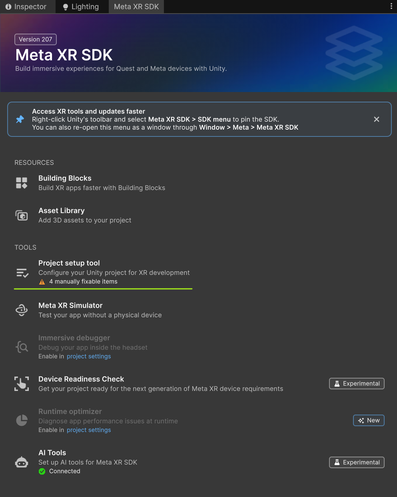

* You can access PST from Unity’s top menu **Window** > **Meta** > **Tools** > **Project Setup Tool**

Once open, you will be presented with a menu that displays all issues and recommendations for solutions. Fix all required Depth API items for your build target and scene, and review the recommended items.

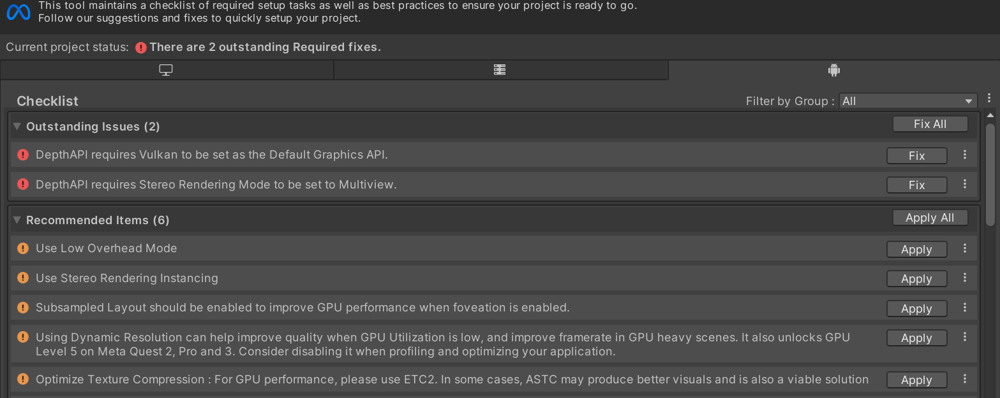

### 4. Adding occlusion shaders to our objects

Depth API supplies shader libraries and a shadergraph subgraph that can help you modify your own shaders and shadergraphs so that they support occlusions, as well as some basic shaders to get you started. For modifying your own shaders, see the [implementing occlusion in custom shaders section](#8-implementing-occlusion-in-custom-shaders) in this documentation. For any object to be occluded, they need to have materials with shaders that support occlusions applied on them.

This repository includes two support packages that supply useful shaders: `com.meta.xr.depthapi` for BiRP and `com.meta.xr.depthapi.urp` for URP. The samples already include the required packages.

To import these Depth API packages into your own Unity project, follow these steps:

* For BiRP, the following package needs to be [imported from a git url](https://docs.unity3d.com/Manual/upm-ui-giturl.html):

```
https://github.com/oculus-samples/Unity-DepthAPI.git?path=/Packages/com.meta.xr.depthapi
```

* If your project uses URP, import this package for access to URP occlusion shaders. The URL for this package is:
```
https://github.com/oculus-samples/Unity-DepthAPI.git?path=/Packages/com.meta.xr.depthapi.urp
```

Depending on which of the [rendering pipelines](https://docs.unity3d.com/Manual/render-pipelines.html) you use in your project, follow the relevant section below.

#### **For BiRP**
Let’s consider the objects in your scene. If you wish to have them be occluded we need to apply the appropriate shader to their materials. If you have an object with a **Standard** shaded material on it, simply change the shader in the material to **Occlusion Standard**. You can find this shader under **Meta/Depth/BiRP** when selecting the shader.

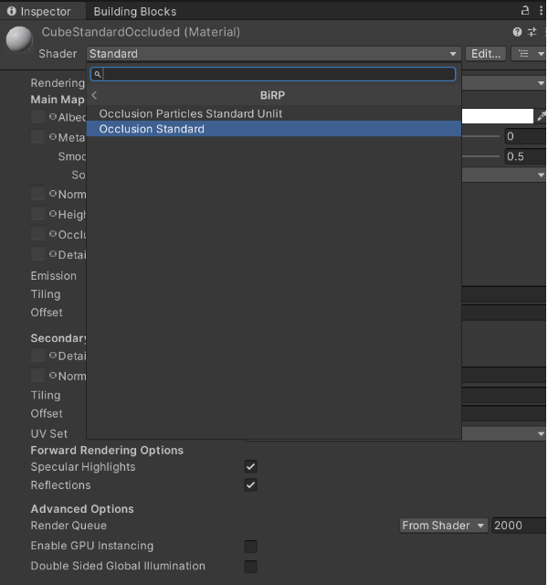


These are the shaders that come pre-packaged with Depth API for BiRP:

| Unity shader              | Depth API shader                   |
|---------------------------|------------------------------------|
| Standard                  | Occlusion Standard                 |
| Particles / Standard Unlit | Occlusion Particles Standard Unlit |

#### **For URP**
Consider the objects in your scene. If we wish to have them be occluded we need to apply the appropriate shader to their materials. If you have an object that has Unity’s **Lit** shaded material in your scene simply change the shader to the Depth API variant shader called **Occlusion Lit**. You can find this shader under **Meta/Depth/URP/** when selecting the shader.

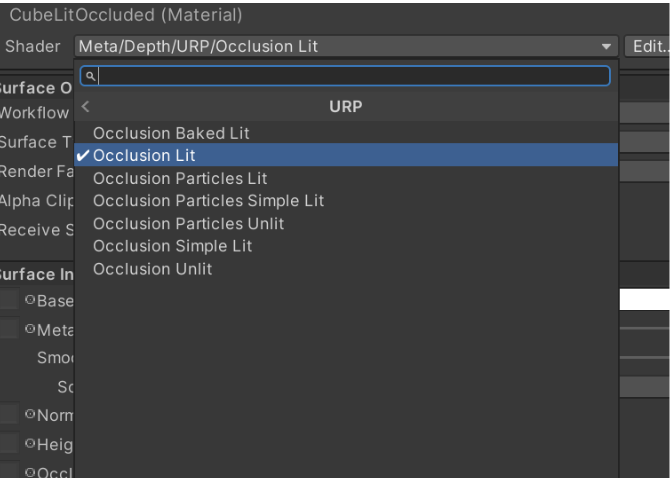

These are the shaders that come prepackaged with Depth API for URP:

| Unity Shader                          | Depth API shader                                |
|---------------------------------------|-------------------------------------------------|
| Lit                                   | Occlusion Lit                                   |
| Unlit                                 | Occlusion Unlit                                 |
| Simple Lit                            | Occlusion Simple Lit                            |
| Baked Lit                             | Occlusion Baked Lit                             |
| Particles / Unlit                      | Occlusion Particles Unlit                       |
| Particles / Lit                       | Occlusion Particles Lit                         |
| Particles / Simple Lit                | Occlusion Particles Simple Lit                  |

### 5. Enabling/configuring occlusions

The **EnvironmentDepthManager.cs** component that we added in the previous steps lets you set occlusion types in your project.

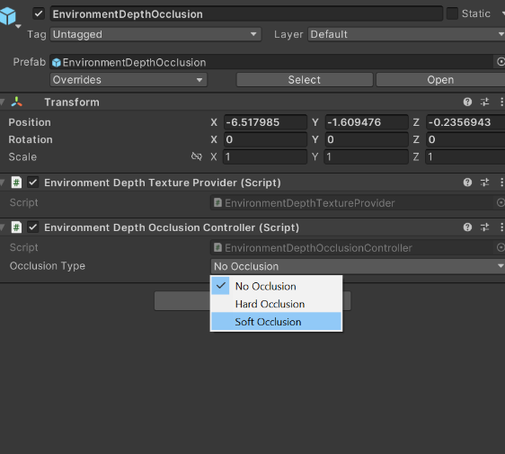

To change occlusion behaviour from code, you may refer to the code snippet below on how to use the API.

Use `using Meta.XR.EnvironmentDepth;` in scripts that access this API. Assign the serialized manager reference in the Inspector. Depth textures become available asynchronously; enabling the component does not guarantee that `IsDepthAvailable` is already true.

```C#
[SerializeField] private EnvironmentDepthManager _environmentDepthManager;
private void Example()
{
    //Check if this feature is supported on your platform
    if(!EnvironmentDepthManager.IsSupported)
    {
        Debug.Log("This feature is not supported");
        return;
    }
    //enables the feature and makes depth textures available
    _environmentDepthManager.enabled = true;

    //sets occlusion mode to "SoftOcclusion" -- this is the default value
    _environmentDepthManager.OcclusionShadersMode = OcclusionShadersMode.SoftOcclusion;

    //sets occlusion mode to "HardOcclusion"
    _environmentDepthManager.OcclusionShadersMode = OcclusionShadersMode.HardOcclusion;

    //sets occlusion mode to "None" -- it's a good idea to disable environmentDepthManager to save resources in this case
    _environmentDepthManager.OcclusionShadersMode = OcclusionShadersMode.None;

    //disables the feature. Frees up resources by not requesting depth textures from the system
    _environmentDepthManager.enabled = false;
}
```
Setting `OcclusionShadersMode.None` stops the global occlusion shader keywords but keeps depth acquisition active while the manager is enabled. Disable the manager when you no longer need depth for occlusion, masking, or raycasting.

#### Occlusions on UI

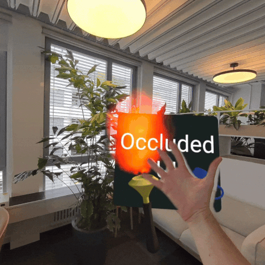

For a **World Space** Canvas, an OcclusionCutout shader is provided in each support package. Follow these steps to add occlusions to your UI:

1) Add a panel or image to your UI hierarchy at the very bottom (so that it is rendered last). Make sure it covers the entire UI.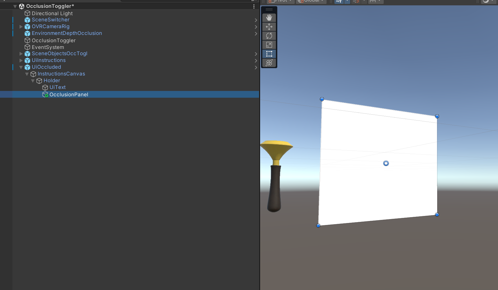
2) Create a new material and assign it the OcclusionCutout shader.
   > For URP select `Meta/EnvironmentDepth/URP/OcclusionCutoutURP`; for BiRP select `Meta/EnvironmentDepth/BiRP/OcclusionCutoutBiRP`.

   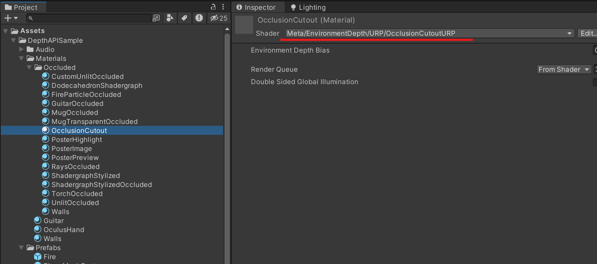
3) Assign the material created at 2) to the panel added at 1) . It's a good idea to remove `Raycast target` from said panel so it doesn't interfere with potential input on your UI.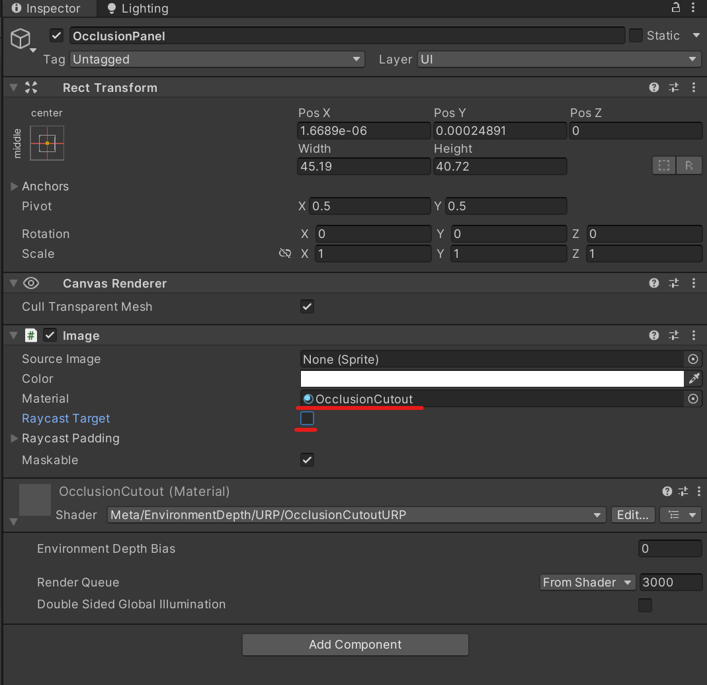

4) (Optional) You may assign an image in the "Source Image" field to have it act like a mask. Anywhere there's is 0 in the source image's alpha channel, occlusions will not occur.

### 6. Using Environment depth bias to solve z-fighting in occlusion shaders

Provided BiRP and URP occlusion shaders have a property that controls environment depth bias. The standard shader variants reuse Unity's material editors, which do not expose this property. The shared `com.meta.xr.depthapi` package provides `OcclusionDepthBias.cs`: attach it to an object with a Renderer, then call `SetDepthBias(float)` to set an absolute bias or `AdjustDepthBias(float)` to add an offset. Enable `DoesAffectChildren` to also update child renderers. Call these methods after the component's `Awake` has initialized its materials.
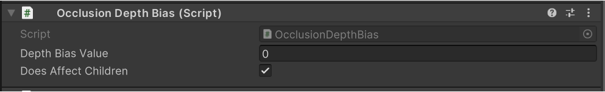

Alternatively, you may set the value of "_EnvironmentDepthBias" from any material that has an occlusion shader on it.

```C#
material.SetFloat("_EnvironmentDepthBias", DepthBiasValue);
```
### 7. Using hands removal

The API supports removing hands from the depth map (in other words, your hands will not occlude virtual content from the wrists up). To use this functionality, simply set the `RemoveHands` property from the depth manager.

Assign the manager reference in the Inspector, then enable hand removal:

```C#
[SerializeField] private EnvironmentDepthManager _environmentDepthManager;

private void Start()
{
    _environmentDepthManager.RemoveHands = true;
}
```

Set `RemoveHands` to `false` to restore hands in the depth map.
> Note: **Hand removal requires hand tracking to be enabled on your headset and your hands to be tracked.**

> Note: **The sample in this repository provides a useful example on how to utilize this feature. In there, we remove hands from the depth map and we replace them with hand tracking hands that we then use as a mask to clip any object under them, yielding high resolution hand occlusion.**

### 8. Implementing occlusion in custom shaders

If you have your own custom shaders you can convert them to occluded versions by applying the changes below. These are snippets to integrate into an existing shader, rather than a complete shader. See `DepthAPI-BiRP/Assets/DepthAPISample/Shaders/ExampleUnlitShader.shader` and `DepthAPI-URP/Assets/DepthAPISample/Shaders/DepthUnlit.shader` for complete examples, including blend states for passthrough.

For BiRP, use the following include statement:
```ShaderLab
#include "Packages/com.meta.xr.sdk.core/Shaders/EnvironmentDepth/BiRP/EnvironmentOcclusionBiRP.cginc"
```
For URP:
```ShaderLab
#include "Packages/com.meta.xr.sdk.core/Shaders/EnvironmentDepth/URP/EnvironmentOcclusionURP.hlsl"
```
#### Step 1. Add occlusion keywords
```Shaderlab
// DepthAPI Environment Occlusion
#pragma multi_compile _ HARD_OCCLUSION SOFT_OCCLUSION
```
#### Step 2. If the struct already contains world coordinates - skip this step, otherwise, use the special macro, META_DEPTH_VERTEX_OUTPUT, to declare the field:
```ShaderLab
struct v2f
{
   float4 vertex : SV_POSITION;


   float2 uv : TEXCOORD0;


   META_DEPTH_VERTEX_OUTPUT(1) // the number should stand for the previous TEXCOORD# + 1


   UNITY_VERTEX_INPUT_INSTANCE_ID
   UNITY_VERTEX_OUTPUT_STEREO // required to support stereo
};
```
#### Step 3. Initialize the world position and clip position
If your vertex output already contains world coordinates, keep your existing world-position assignment. Otherwise, use `META_DEPTH_INITIALIZE_VERTEX_OUTPUT`. This BiRP example also assigns the clip position; in URP, replace `UnityObjectToClipPos(v.vertex)` with `TransformObjectToHClip(v.vertex.xyz)` and pass `v.vertex.xyz` to `META_DEPTH_INITIALIZE_VERTEX_OUTPUT`.
```Shaderlab
v2f vert (appdata v) {
   v2f o;

   UNITY_SETUP_INSTANCE_ID(v);
   UNITY_TRANSFER_INSTANCE_ID(v, o);
   UNITY_INITIALIZE_VERTEX_OUTPUT_STEREO(o); // required to support stereo

   o.vertex = UnityObjectToClipPos(v.vertex);
   o.uv = v.uv;

   META_DEPTH_INITIALIZE_VERTEX_OUTPUT(o, v.vertex);

   return o;
}
```
#### Step 4. Calculate occlusions in fragment shader, with the use of the META_DEPTH_OCCLUDE_OUTPUT_PREMULTIPLY macro:
```Shaderlab
half4 frag(v2f i) : SV_Target {
   UNITY_SETUP_INSTANCE_ID(i);
   UNITY_SETUP_STEREO_EYE_INDEX_POST_VERTEX(i); // required to support stereo

   // this is something your shader will return without occlusions
   half4 fragmentShaderResult = someColor;

   // Third field is for environment depth bias. 0.0 means the occlusion will be calculated with depths as they are.
   META_DEPTH_OCCLUDE_OUTPUT_PREMULTIPLY(i, fragmentShaderResult, 0.0);

   return fragmentShaderResult;
}
```
If you already have a world position varyings being passed to your fragment shader, you can use this macro:
```Shaderlab
META_DEPTH_OCCLUDE_OUTPUT_PREMULTIPLY_WORLDPOS(yourWorldPosition, fragmentShaderResult, 0.0);
```

> Note: **If you only get occlusions working in one eye, make sure that you added the UNITY_SETUP_STEREO_EYE_INDEX_POST_VERTEX(i) macro in your fragment shader and the subsequent macros related to stereo rendering as outlined in the above code snippets that have the `// required to support stereo` comment**

### 9. Using Shader Graph

Depth API supports adding occlusions via Shader Graph. A subgraph called `OcclusionSubGraph` is provided in Meta XR Core SDK under `Shaders/EnvironmentDepth/URP/Shadergraph`. It outputs visibility: 0 for fully occluded pixels, 1 for visible pixels, and intermediate values at soft-occlusion edges.

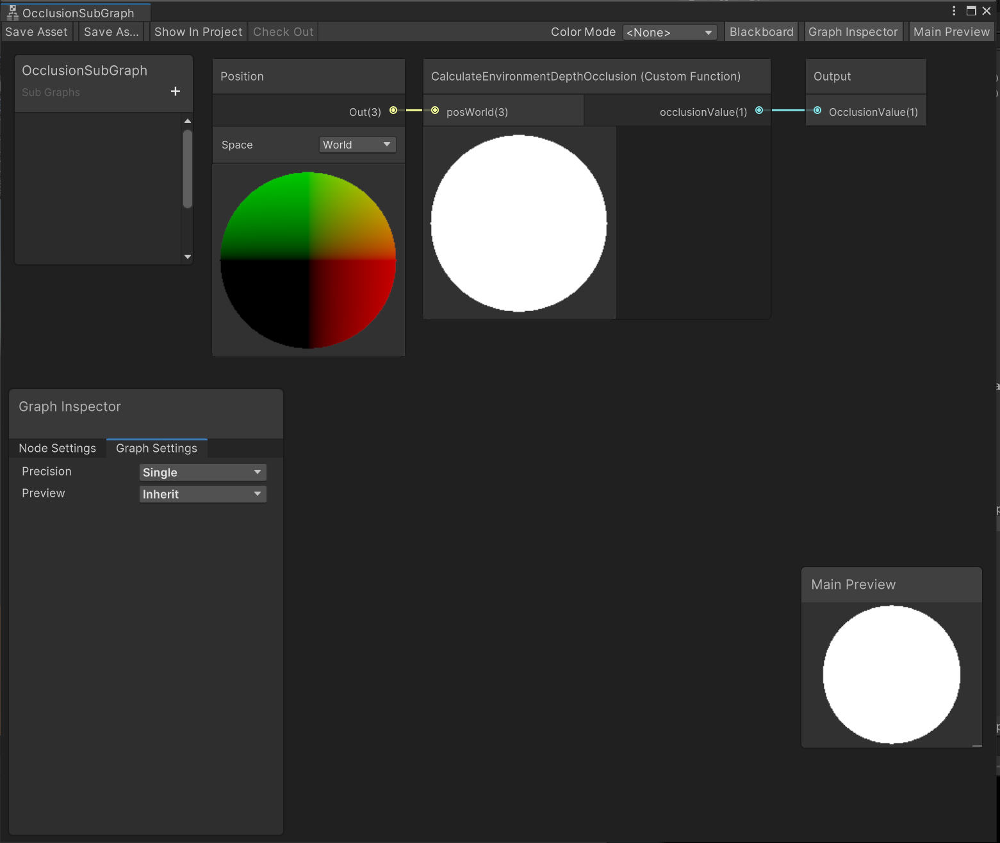

To aid in its usage, Meta XR Core SDK and the URP sample project provide some example use cases:

#### 1. LitOccluded
This is a simple Shader Graph that uses the aforementioned subgraph to implement occlusions. It works by multiplying the final color's alpha value with the occlusion value. The result will be either the original alpha color if not occluded or it will be 0 if the object is occluded. To occlude the object, we feed in this value in the final alpha value of the fragment shader, enable Alpha Clipping and set the threshold to 0.01 (or a very small value that is greater than 0). This shadergraph is located in Meta XR Core SDK, under `Shaders/EnvironmentDepth/URP/Shadergraph`.

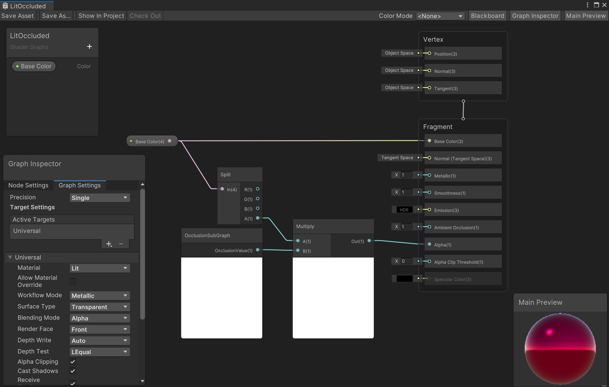

#### 2. Stylized shaders
Once an object is occluded we can alternatively apply various effects to it rather than clip it from view. For instance, the stylized occlusion Shader Graph example makes occluded items "wavy" when occluded.


### 10. Depth masking

Use `EnvironmentDepthManager.MaskMeshFilters` to supply meshes for removing matching surfaces from the environment depth map. `MaskBias` adjusts the comparison between the mesh depth and the measured environment depth to reduce z-fighting. Clear the list to disable masking. The `DepthMask` sample uses MRUK wall meshes and shows how to toggle the mask and adjust its bias.

### 11. Raycasting

Environment depth raycasting is provided by [MRUK](https://developers.meta.com/horizon/documentation/unity/unity-mr-utility-kit-overview). You can find more information on it [here](https://developers.meta.com/horizon/documentation/unity/unity-mr-utility-kit-features#environment-raycasting-beta). There's also a sample within MRUK that showcases its usage [here](https://developers.meta.com/horizon/documentation/unity/unity-mr-utility-kit-samples#environment-panel-placement).

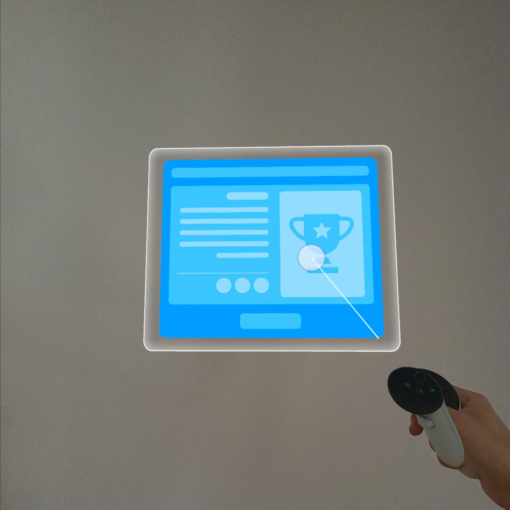

### 12. Testing
Build the app for Android and install it on a Quest 3, Quest 3S, or Meta VR Glasses. Grant spatial data permission and verify that objects using occlusion shaders are occluded by the physical environment. Complete Space Setup before using the SceneAPIPlacement and DepthMask scenes.

For testing in the Editor over Meta Quest Link, enable **Settings > Developer > Spatial Data over Meta Quest Link** in the Meta Quest Link desktop app. Use PST to check the Standalone setup as well as Android.

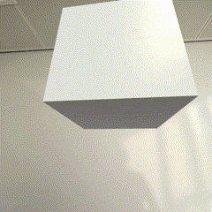

### 13. Updating from pre v67 version of Depth API

Depth API's runtime implementation moved into Meta XR Core SDK in v67. When migrating an older project to the v209 setup:

* Install Meta XR Core SDK v209 and the support packages for your render pipeline, if needed.
* Replace `EnvironmentDepthTextureProvider` and `EnvironmentDepthOcclusionController` with a single `EnvironmentDepthManager` component. Scripts should use the `Meta.XR.EnvironmentDepth` namespace.
* Replace `SetEnvironmentDepthEnabled(bool)` with the manager's `enabled` property, `EnableOcclusionType(...)` with `OcclusionShadersMode`, and `RemoveHands(bool)` with the `RemoveHands` property.
* Check `EnvironmentDepthManager.IsSupported` before enabling depth, and `IsDepthAvailable` before using its data.
* Update custom shader includes to the Core SDK paths:

```ShaderLab
#include "Packages/com.meta.xr.sdk.core/Shaders/EnvironmentDepth/BiRP/EnvironmentOcclusionBiRP.cginc"
```

For URP:

```ShaderLab
#include "Packages/com.meta.xr.sdk.core/Shaders/EnvironmentDepth/URP/EnvironmentOcclusionURP.hlsl"
```

* Run PST and apply the requirements for the selected XR provider.

### 14. Troubleshooting

* If depth is unavailable, check `EnvironmentDepthManager.IsSupported`, spatial data permission, and `IsDepthAvailable`. An enabled manager waits for permission and a depth frame; it does not make depth available immediately.
* Run PST for the active build target and scene. For OpenXR, verify that **Occlusions** and **Session** are enabled, Render Mode is **Single Pass Instanced**, and Android uses Vulkan.
* If occlusion works in only one eye, check the stereo initialization and fragment shader macros in [Implementing occlusion in custom shaders](#8-implementing-occlusion-in-custom-shaders).
* If the SceneAPIPlacement or DepthMask scene has no room data, complete Space Setup on the headset and ensure spatial data permission is granted.
* For Editor testing over Link, enable **Spatial Data over Meta Quest Link** in the desktop app. If resetting the view offsets occlusion, restart the session.
* For z-fighting near physical surfaces, adjust `_EnvironmentDepthBias` on occlusion materials or `MaskBias` when using depth masking.

## Licenses
The Meta License applies to the SDK and supporting material. The MIT License applies to only certain, clearly marked documents. If an individual file does not indicate which license it is subject to, then the Meta License applies.
